# ScoreSharp – Online Exam Portal

ScoreSharp is a web-based online assessment platform built to support exam administration and candidate assessments. It combines an Angular frontend with a Java Spring Boot microservices backend and supports both multiple-choice questions (MCQs) and coding questions.

## Screenshots

The screenshots below are taken from the project's documentation and show the application's main candidate and administrator workflows.

### Candidate experience

| Home page | Registration page |
|---|---|
| 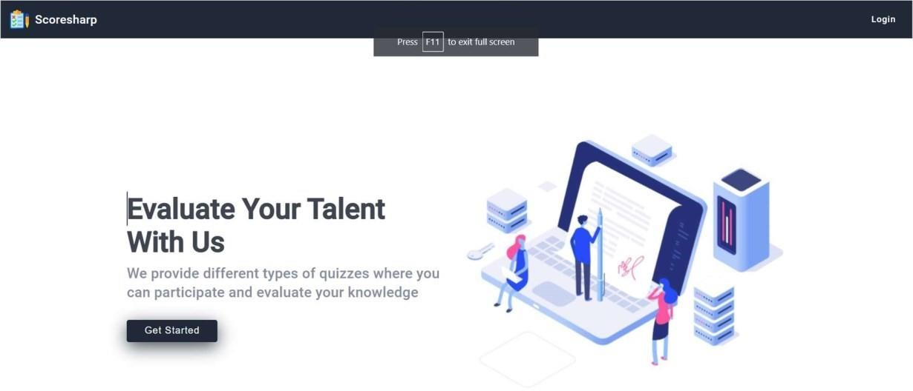 | 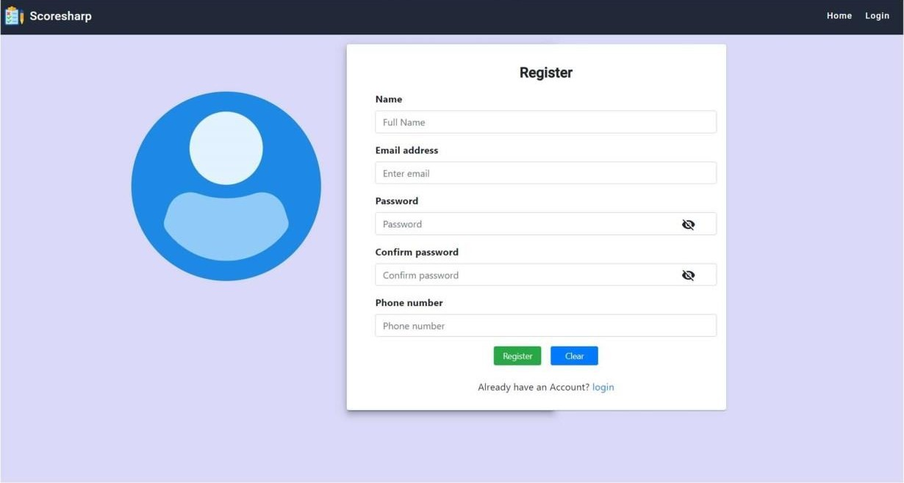 |

| Login page | Candidate access-code page |
|---|---|
| 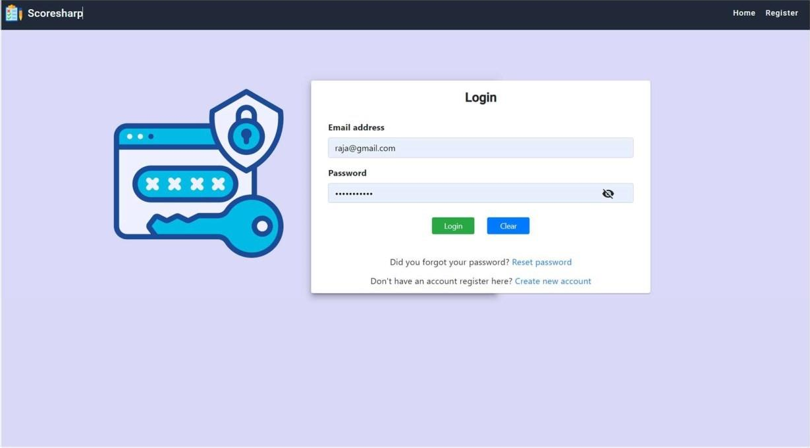 | 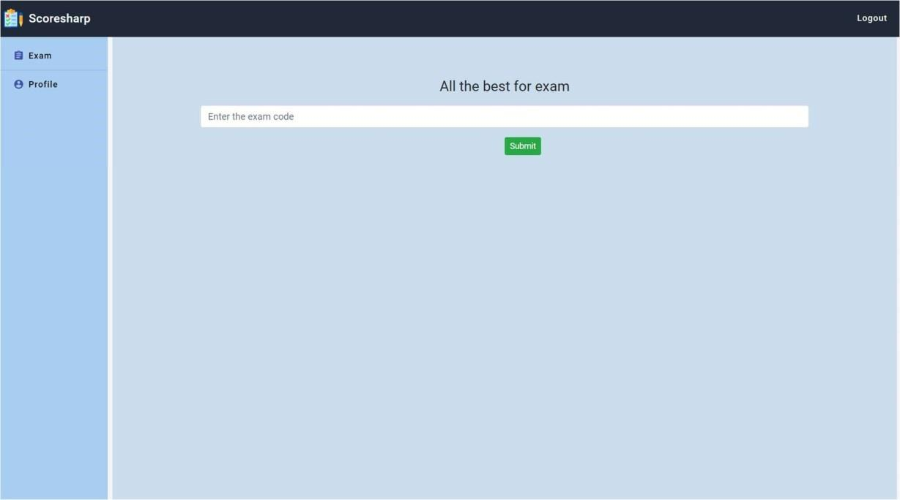 |

### Taking an exam and reviewing results

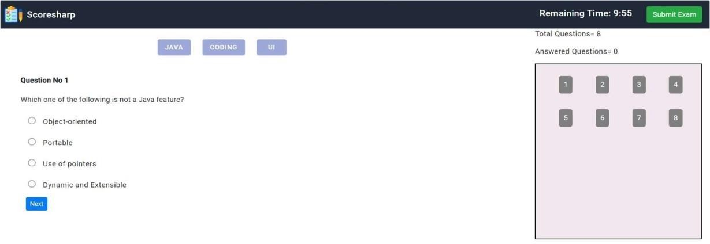

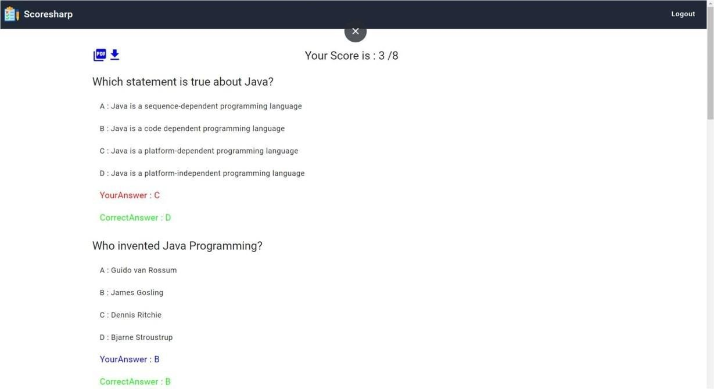

### Administrator experience

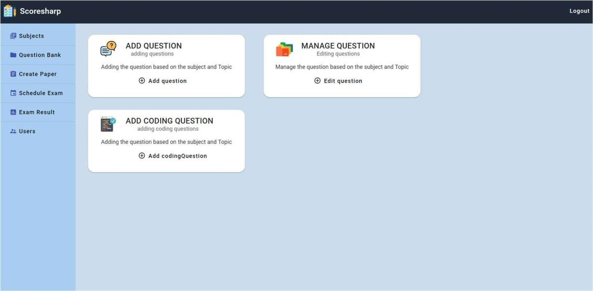

| Add MCQ | Manage questions |
|---|---|
| 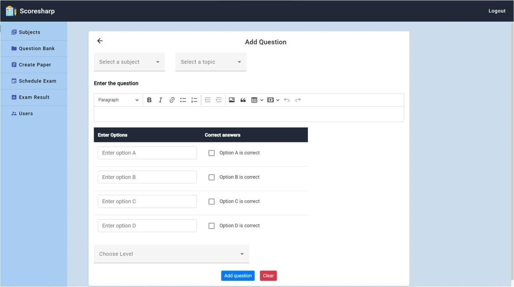 | 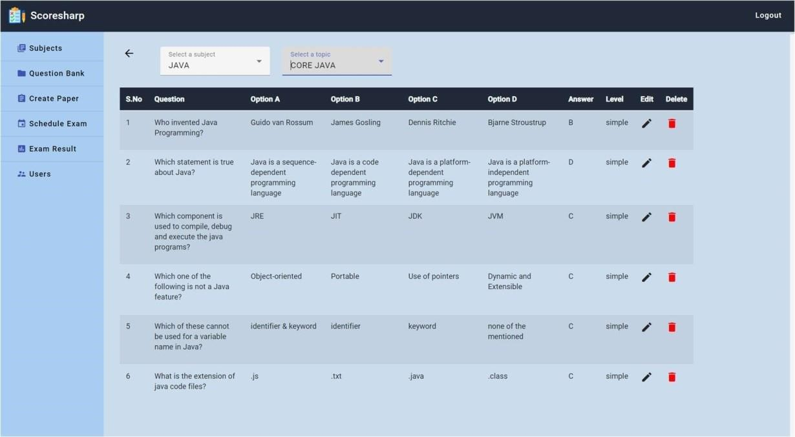 |

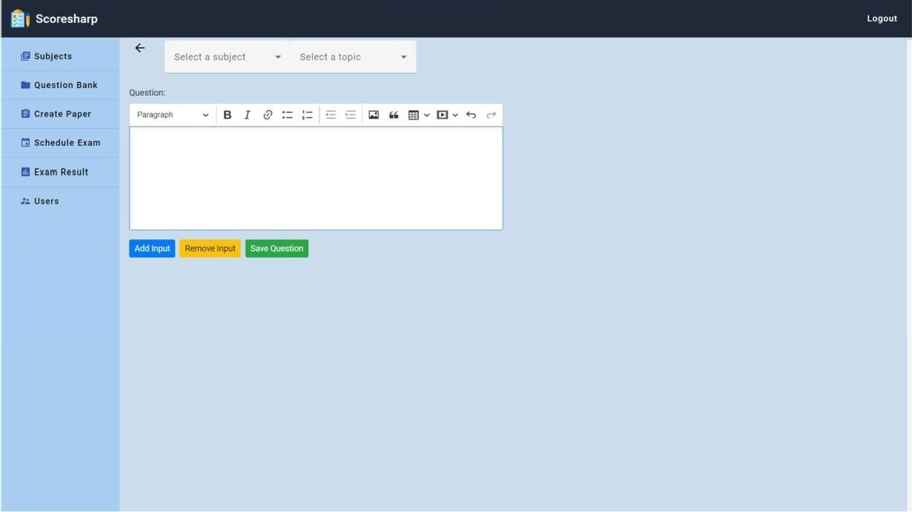

| Create paper | Schedule exam |
|---|---|
| 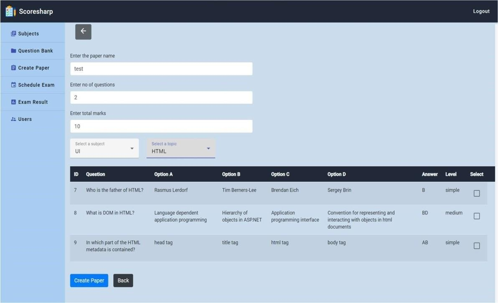 | 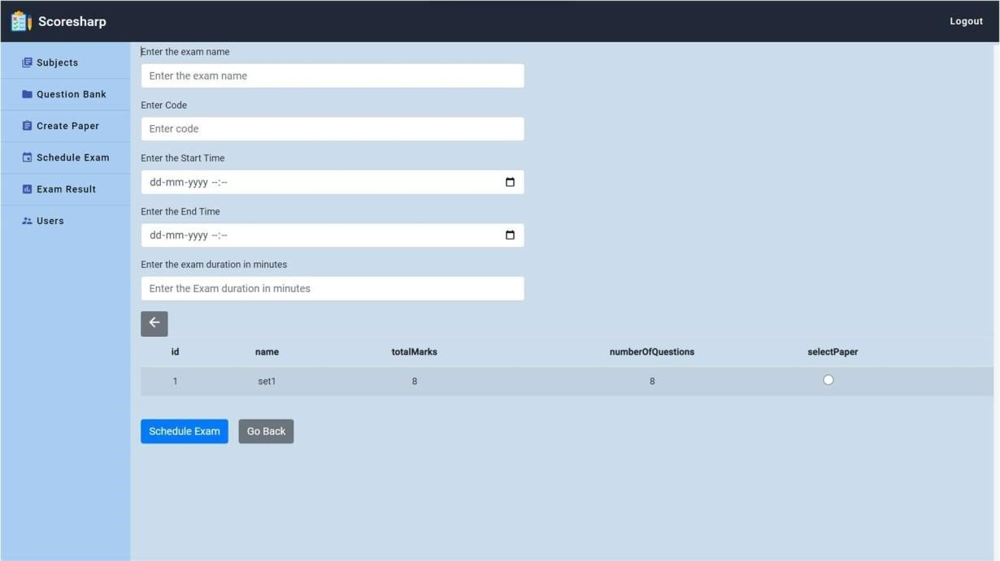 |

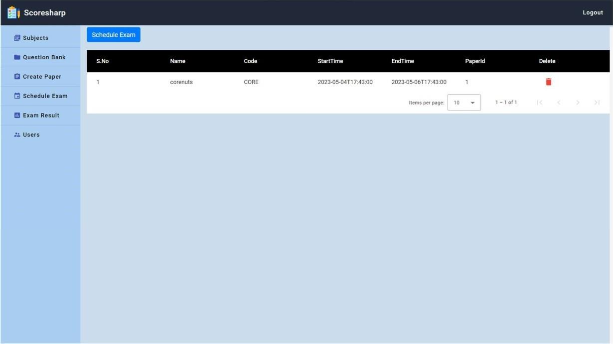

### Analytics and user management

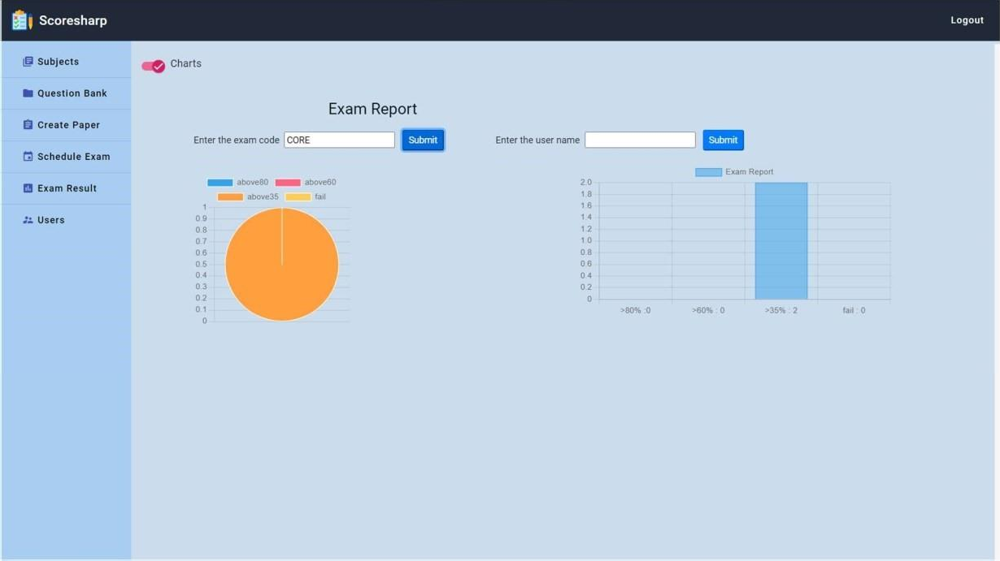

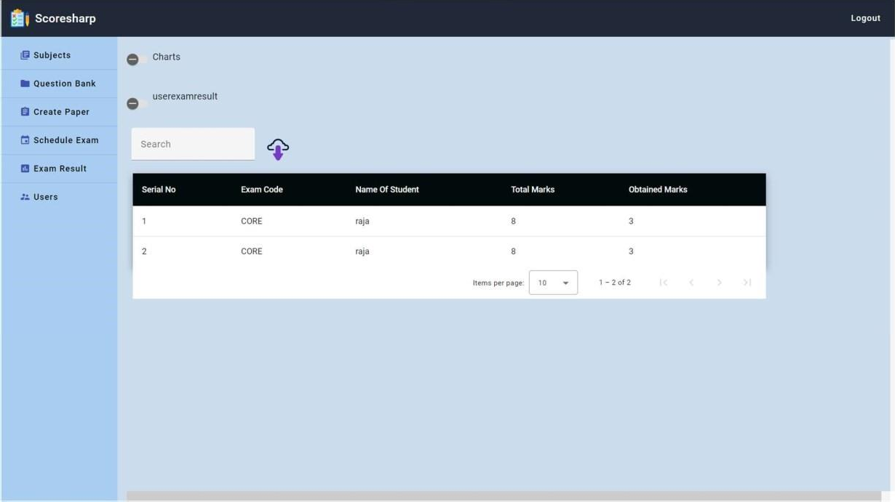

## Features

- Candidate registration and login
- Exam access using an administrator-provided access code
- Timed assessments with question navigation
- MCQ and coding-question workflows
- Centralized subject and question management
- Exam-paper creation and scheduling
- Results and answer review
- Exam performance analytics and registered-user management

## Technology stack

**Frontend:** Angular, TypeScript, HTML, CSS, Angular Material  
**Backend:** Java 11, Spring Boot 2.7, Spring Data JPA, Spring Security, REST APIs, microservices  
**Database:** MySQL  
**Supporting tools/components:** Maven, Git, Spring Cloud components, Apache Kafka

## Project structure

```text
ScoreSharp-GitHub/
├── exam-portal-angular/   # Angular frontend
├── Micro-Services/        # Java/Spring Boot backend services
├── screenshots/           # Screenshots used in this README
└── README.md
```

## Prerequisites

Install the software versions compatible with the project:

- JDK 11
- Node.js and npm
- Angular CLI compatible with the frontend's `package.json`
- MySQL Server
- Maven, if it is not available through your IDE or project tooling

## Setup and running

The project contains multiple backend services, so configure and start each required service before starting the Angular frontend.

### 1. Configure MySQL and backend settings

1. Create a local MySQL database using the database name expected by the backend configuration.
2. Configure your local database username and password in the appropriate local application configuration or environment variables.
3. Check the Spring Cloud Config Server configuration and any supporting services required by the backend.
4. Make sure the configured service ports match the API URLs used by the Angular frontend.

Use your own local credentials. Do not commit real passwords, access tokens, or other secrets to GitHub. Exact database settings and startup order should be confirmed against the configuration files included in the repository.

### 2. Start the backend

Open the backend project in an IDE such as Spring Tool Suite/Eclipse, or use Maven from each service directory. Start the required configuration/supporting services and then the application microservices according to their configuration.

For a Maven service, the usual command is:

```bash
mvn spring-boot:run
```

Run it from a service directory containing that service's `pom.xml`. This command should only be used after the service's required configuration has been supplied.

### 3. Start the Angular frontend

Open a terminal in `exam-portal-angular` and run:

```bash
npm install
ng serve
```

Then open `http://localhost:4200` in your browser. The backend services must already be running at the API URLs configured by the frontend.

## Configuration and security notes

- Localhost API URLs are intended for local development and require the backend services to be running on the configured ports.
- Database credentials and other secrets should be supplied locally and must not be published in source control.
- If a required local configuration file is ignored by Git, recreate it from the provided example or setup instructions before running the application.

## Screenshots source

Screenshots in this repository were extracted from the project's ScoreSharp documentation for demonstration purposes.
